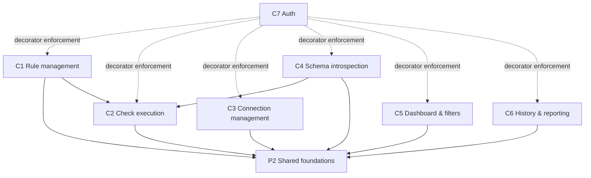

# Evidence: structure

## Graph sources

| Language | Source | Level | Confidence | Blind spots |
|----------|--------|-------|------------|-------------|
| Python   | Import statements read via `read` tool (manual AST walk) | 4 — universal fallback | low-medium | Dynamic imports in `models.py` (`from urllib.parse import urlparse` inside a method, `from cryptography.fernet import Fernet` inside a try/except at module load); both are stdlib/external, no intra-project edges missed. No aliases or re-exports detected. |

Edges written to `context/map/.work/edges-py.csv` (9 runtime edges, 0 type-only, 0 build).

---

## Entry point table

| URL pattern | View function | Capability | Tag |
|-------------|--------------|------------|-----|
| `GET /` | `dashboard` | C5 Dashboard & filters | evidence |
| `POST /run/` | `run_checks` | C2 Check execution | evidence |
| `POST /rules/new/` | `rule_create` | C1 Rule management | evidence |
| `GET /rules/<id>/` | `rule_history` | C6 History & reporting | evidence |
| `POST /rules/<id>/run/` | `run_single` | C2 Check execution | evidence |
| `POST /rules/<id>/edit/` | `rule_edit` | C1 Rule management | evidence |
| `POST /rules/<id>/delete/` | `rule_delete` | C1 Rule management | evidence |
| `GET /api/schema/<id>/tables/` | `api_schema_tables` | C4 Schema introspection | evidence |
| `GET /api/schema/<id>/columns/<schema>/<table>/` | `api_schema_columns` | C4 Schema introspection | evidence |
| `GET /connections/` | `connection_list` | C3 Connection management | evidence |
| `POST /connections/new/` | `connection_create` | C3 Connection management | evidence |
| `POST /connections/<id>/edit/` | `connection_edit` | C3 Connection management | evidence |
| `POST /connections/<id>/delete/` | `connection_delete` | C3 Connection management | evidence |
| `GET /login/` | `auth_views.LoginView` (Django built-in) | C7 Auth | evidence |
| `GET /logout/` | `auth_views.LogoutView` (Django built-in) | C7 Auth | evidence |
| `GET /admin/` | Django admin (built-in) | P1 Platform & infra | evidence |

Note (false-signal rule 2): `data_pulse/urls.py` imports `monitor.urls` — this is standard Django URL routing config, not an architecture coupling.

---

## Dependency graph — module → imports (runtime, intra-project only)

```
monitor/models.py
  ← django.db, django.utils.timezone, django.conf.settings (external)
  ← cryptography.fernet (external, optional — try/except guarded)
  ← urllib.parse (stdlib, inside method — lazy)
  → (no intra-project imports)

monitor/forms.py
  → monitor/models.py  [Connection, Rule]

monitor/services.py
  → monitor/models.py  [CheckRun, Connection, Rule, RuleResult]
  ← psycopg2 (external)
  ← django.utils.timezone (external)

monitor/views.py
  → monitor/forms.py   [ConnectionForm, RuleForm]
  → monitor/models.py  [CheckRun, Connection, Rule, RuleResult]
  → monitor/services.py [get_schema_columns, get_schema_tables, run_all_checks, run_single_rule]

monitor/urls.py
  → monitor/views.py   (all view functions)

data_pulse/urls.py
  → monitor/urls.py    (include)
  ← django.contrib.auth.views (external)

monitor/management/commands/run_scheduled.py
  → monitor/models.py  [Rule]
  → monitor/services.py [run_single_rule]
```

Tags: all intra-project edges — evidence; external deps — evidence.

Capability-level dependency summary (runtime edges only):

| From (capability) | To (capability) | Edge count |
|-------------------|-----------------|------------|
| C1 Rule management | P2 Shared foundations (models) | 2 (forms→models, views→models) |
| C1 Rule management | C2 Check execution (services) | 1 (views→services) |
| C2 Check execution | P2 Shared foundations (models) | 2 (services→models, cmd→models) |
| C3 Connection management | P2 Shared foundations (models) | 1 (views→models) |
| C4 Schema introspection | C2 Check execution (services) | 1 (views→services) |
| C4 Schema introspection | P2 Shared foundations (models) | 1 (views→models) |
| C5 Dashboard & filters | P2 Shared foundations (models) | 1 (views→models) |
| C6 History & reporting | P2 Shared foundations (models) | 1 (views→models) |
| All Cx | C7 Auth | 0 direct imports — C7 is enforced by `@login_required` decorator on every view function | inference |



(Dashed arrows = Django `@login_required` decorator — enforcement, not import coupling. Tag: inference.)

---

## Blast radius per capability

### C2 — Check execution (services.py change) — HIGH criticality

**Incoming — who depends on C2 at runtime:**

| Dependent | How | Affected capabilities |
|-----------|-----|-----------------------|
| `monitor/views.py` | imports `run_all_checks`, `run_single_rule`, `get_schema_tables`, `get_schema_columns` | C1 (run_single view), C2 (run_checks view), C4 (api_schema_* views) |
| `monitor/management/commands/run_scheduled.py` | imports `run_single_rule` | C2 (scheduled runs) |

**Outgoing — what C2 depends on:**

| Dependency | Kind |
|------------|------|
| `monitor/models.py` (P2) | runtime — reads/writes CheckRun, Rule, RuleResult, Connection |
| `psycopg2` | external runtime — direct DB connections to monitored PostgreSQL |

**Blast radius summary (C2 change):** evidence

A breaking change to `services.py` (signatures of `run_all_checks`, `run_single_rule`, `get_schema_tables`, `get_schema_columns`) directly breaks:
- C2 itself (run_checks, run_single views)
- C4 (api_schema_tables, api_schema_columns views — share services.py)
- C1 (run_single_rule called from rule views via POST to `/rules/<id>/run/`)
- Render Cron job `run_scheduled` (C2)

C3, C5, C6 are NOT directly affected — they do not import from `services.py`.

**Contracts exported by C2 that other capabilities import:**

| Symbol | Importer | Capability |
|--------|----------|------------|
| `run_all_checks()` | `views.run_checks` | C2 |
| `run_single_rule(rule)` | `views.run_single`, `run_scheduled.Command.handle` | C2 |
| `get_schema_tables(conn_id)` | `views.api_schema_tables` | C4 |
| `get_schema_columns(conn_id, schema, table)` | `views.api_schema_columns` | C4 |

Tags: evidence (imports verified in source); inference (blast radius propagation).

---

## Cycles

**Runtime cycles: NONE** — evidence

The dependency graph is a strict DAG:
```
data_pulse/urls.py → monitor/urls.py → monitor/views.py → monitor/services.py → monitor/models.py
                                                         → monitor/forms.py   → monitor/models.py
monitor/management/commands/run_scheduled.py → monitor/services.py → monitor/models.py
```
No module imports back to its caller. `monitor/models.py` has zero intra-project imports.

The single potentially confusing edge: `views.py` imports from both `forms.py` and `services.py`, while `forms.py` imports from `models.py` and `services.py` imports from `models.py`. None of these import `views.py`. No cycle. Tag: evidence.

---

## Broken boundaries

Intended layering (inferred from Django conventions):
```
models (P2) → forms (C1) → services (C2) → views (all Cx) → urls (routing)
```

Violations found: **NONE** — inference

The actual import graph follows the intended layering exactly. `services.py` does not import `forms.py` or `views.py`. `models.py` does not import any other project module. `forms.py` does not import `services.py` or `views.py`.

One note: `views.py` is a single file serving 7 capabilities (C1–C7 except C7's login form). This is a Django monolith pattern — not a broken boundary, but a discoverability concern (see Test risks). Tag: inference.

---

## Test risks

| Capability | Risk | Reason | Tag |
|------------|------|--------|-----|
| C2 Check execution | HIGH | `run_all_checks` / `run_single_rule` in `services.py` opens live `psycopg2` connections to external PostgreSQL; no dependency injection, connection taken from `rule.connection.get_database_url()` | evidence |
| C4 Schema introspection | HIGH | Same issue — `get_schema_tables` / `get_schema_columns` open live connections; AJAX endpoints served through session cache, so integration tests need a real or mocked psycopg2 | evidence |
| C3 Connection management | MEDIUM | `Connection.get_database_url()` uses `cryptography.Fernet` keyed by `settings.FIELD_ENCRYPTION_KEY`; tests need the key set in env or the fallback (no encryption) exercised | evidence |
| C1 Rule management | LOW | Pure Django form + model CRUD; testable with `TestClient` and SQLite; no external deps | inference |
| C5, C6 | LOW | Read-only views; Django ORM only | inference |
| C7 Auth | LOW | Django built-in `LoginView`/`LogoutView`; decorator coverage tested via any protected URL | inference |

Isolation strategy for C2/C4: mock `psycopg2.connect` or use `unittest.mock.patch('monitor.services.psycopg2.connect', ...)` — no dependency injection point exists today. Tag: inference.

---

## Centres and thin entry points

| Module | Ca (depended on by) | Ce (depends on) | Instability | Role |
|--------|---------------------|-----------------|-------------|------|
| `monitor/models.py` | 4 (forms, services, views, run_scheduled) | 0 | 0.0 — stable | Load-bearing centre; P2 |
| `monitor/services.py` | 2 (views, run_scheduled) | 1 (models) | 0.33 | Core domain logic; C2 + C4 |
| `monitor/views.py` | 1 (urls.py) | 3 (forms, models, services) | 0.75 — unstable | Thin entry point; aggregates all Cx |
| `monitor/forms.py` | 1 (views) | 1 (models) | 0.5 | Leaf; C1 + C3 |
| `monitor/urls.py` | 1 (data_pulse/urls) | 1 (views) | 0.5 | Routing config; false signal (rule 2) |
| `monitor/management/commands/run_scheduled.py` | 0 | 2 (models, services) | 1.0 — maximally unstable | Entry point only; C2 |

**Load-bearing centre:** `monitor/models.py` — Ca=4, Ce=0, instability=0.0. All capabilities consume it; any breaking change here has maximum blast radius. Tag: evidence/inference.

**Thin entry point:** `monitor/views.py` — it delegates to services and forms; it is the integration layer but not the core. The real domain logic sits in `services.py`. Tag: inference.

(False-signal rule 2 applied to `data_pulse/urls.py` — its import of `monitor.urls` is routing config, not architecture.)

---

## Mechanical signals

- `data_pulse/urls.py → monitor/urls.py`: routing config (false-signal rule 2) — not an architecture edge.
- `monitor/models.py` try/except import of `cryptography.fernet` at module load: optional dependency, gracefully degraded; not a coupling risk.
- `requirements.txt` is auto-generated by `uv pip compile` (false-signal rule 3 + 7) — not a source of co-change risk.

---

## External dependencies

| Package | Version (pinned) | Used by | Risk note | Tag |
|---------|-----------------|---------|-----------|-----|
| `django` | 6.1.1 | entire project | Pre-release / unreleased version (Django 6.x does not exist as of 2024; likely dev/alpha or future). Monitor for security patches. | evidence |
| `psycopg2-binary` | 2.9.13 | `monitor/services.py` | Binary wheel; no source-build fallback on unusual platforms. Critical path: all C2/C4 functionality fails without it. | evidence |
| `cryptography` | not pinned (not in requirements.txt) | `monitor/models.py` (optional) | **Not listed in requirements.txt.** Import is try/except guarded; if absent, Connection URLs stored unencrypted. Silent degradation — risk depends on deployment env. | evidence |
| `dj-database-url` | 3.1.2 | `data_pulse/settings.py` | Stable, narrow-scope utility. Low risk. | evidence |
| `django-environ` | 0.14.0 | `data_pulse/settings.py` | Stable. Low risk. | evidence |
| `gunicorn` | 26.2.0 | Render deploy (P1) | Production WSGI server. Stable. | evidence |
| `whitenoise` | 6.12.0 | `settings.py` middleware | Static file serving. Low risk. | evidence |
| `sqlparse` | 0.6.0 | Indirect (django dep) | Low risk. | evidence |
| `asgiref` | 3.12.1 | Indirect (django dep) | Low risk. | evidence |

**Notable gap:** `cryptography` is used in `models.py` but absent from `requirements.txt` and `pyproject.toml`. If not present in the environment, `_FERNET_AVAILABLE = False` and all Connection URLs are stored in plaintext. Tag: evidence.

---

## Unknowns

- **Render Cron scheduling runtime coupling:** the cron job invocation (`run_scheduled`) is configured in `render.yaml` — the actual schedule is in infra config, not Python imports. Blast radius of P1 changes includes C2 scheduled runs. Tag: unknown.
- **Session-based schema cache (C4):** `api_schema_tables` / `api_schema_columns` write to `request.session`; this is a Django session backend runtime coupling not visible in imports. Tag: unknown.
- **`FIELD_ENCRYPTION_KEY` secret:** presence/absence changes `models.py` behaviour at runtime; no import reflects this. Tag: unknown.
- **Django admin (C7/P1):** `/admin/` is registered via `django.contrib.admin`; admin-registered models are implicit couplings not visible in `monitor/` imports. Tag: unknown.
- **No dedicated graph tool found on this machine** (no `pydeps`, `pyreverse`, `ast-grep`); fallback 4 (manual import read) used. Tool worth installing: `pydeps` or `pyreverse` (pylint) for automated graph and cycle detection.

---

## Commands run

1. `read monitor/urls.py` — URL pattern enumeration
2. `read monitor/views.py` — view imports and function assignments
3. `read monitor/models.py` — model imports and intra-project deps
4. `read monitor/forms.py` — form imports
5. `read monitor/services.py` — service imports and exported symbols
6. `read monitor/management/commands/run_scheduled.py` — management command imports
7. `read data_pulse/urls.py` — root URL conf
8. `read requirements.txt` — external dependency list
9. `read data_pulse/settings.py` — installed apps, middleware, DB config
10. `read pyproject.toml` — declared dependencies (cross-check with requirements.txt)
11. `read context/map/.work/capabilities.tsv` — capability-to-file mapping
12. `read context/map/.work/scan-contract.md` — scan parameters
