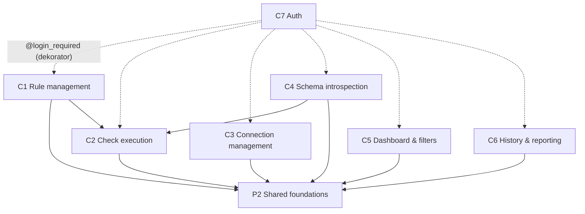

## TL;DR

DataPulse to webowa aplikacja Django do monitorowania jakości danych w PostgreSQL. Użytkownik definiuje reguły (volume, freshness, custom SQL), przypisuje je do połączeń z bazami danych i uruchamia sprawdzenia, które zwracają wynik OK/FAIL/ERROR. Projekt jest w fazie aktywnego budowania — 17 commitów w 9 dni przez jedną osobę wspomaganą przez AI. Największy buzz skupia się na **C2 (uruchamianie sprawdzeń)** i **P2 (fundament: modele i migracje)** — obydwa kwalifikują się do stref ryzyka. `monitor/services.py` to centrum logiki domenowej i jednocześnie największy promień rażenia w architekturze. `monitor/views.py` to monolityczny plik wejściowy obsługujący wszystkie 7 możliwości produktowych — nie jest to złamana granica, lecz ogranicza wykrywalność.

*(Graf pochodzi z evidence/3-structure.md — krawędzie przerywane to wymuszenie dekoratorem, nie import.)*

---

## Teren

### Możliwości produktowe

| ID | Możliwość | Co robi | Krytyczność | Buzz — zmiana | Buzz — fix pressure | Buzz — tarcie | Buzz — uwaga | Buzz — zasięg | Trend | Gdzie mieszka |
|----|-----------|---------|-------------|---------------|---------------------|---------------|--------------|---------------|-------|---------------|
| C1 | Rule management | CRUD reguł (volume/freshness/custom SQL), harmonogram | **wysoka** | M¹ | L (0 prawdziwych) | L | M (2 foldery change) | M | rosnący | monitor/models.py, monitor/forms.py, monitor/views.py (rule_*), templates/monitor/rule_*.html |
| C2 | Check execution | Uruchamianie sprawdzeń, wyniki OK/FAIL/ERROR | **wysoka** | M¹ | **M** (1 prawdziwy: dispatcher) | **H** (silent bug po refaktorze) | M | **H** (blast: C1, C4, Cron) | rosnący | monitor/services.py, monitor/views.py (run_*), monitor/management/commands/run_scheduled.py |
| C3 | Connection management | CRUD połączeń PostgreSQL, szyfrowany URL | **wysoka** | M¹ | L (0 prawdziwych) | L | M | L | rosnący | monitor/models.py (Connection), monitor/views.py (connection_*), templates/monitor/connection_*.html |
| C4 | Schema introspection | AJAX: tabele i kolumny z monitorowanej DB | średnia | M¹ | M (współdzielony z C2) | M (session cache) | M | M | rosnący | monitor/services.py (get_schema_*), monitor/views.py (api_schema_*) |
| C5 | Dashboard & filters | Widok główny, KPI, filtry reguł z URL persistence | średnia | M¹ | L (spillover) | L | M | L | rosnący | templates/monitor/dashboard.html, monitor/views.py (dashboard) |
| C6 | History & reporting | Historia wyników per reguła | średnia | M | M (1 prawdziwy: view przypadkowo usunięty) | M (collateral drop) | M | L | rosnący | templates/monitor/rule_history.html, monitor/views.py (rule_history) |
| C7 | Auth | Login/logout, ochrona widoków dekoratorem | **wysoka** | L¹ | L (spillover) | M (brak change doc, słabe testy) | L | L | rosnący | templates/login.html, data_pulse/urls.py, monitor/views.py (@login_required) |

> ¹ Surowe liczby commitów zawyżone przez `monitor/views.py` (monolityczny plik mapowany na C1–C7 jednocześnie) — false-signal rule 2 + 4. Po korekcie: buzz zmiany nie jest niezależnym sygnałem dla żadnej możliwości korzystającej z views.py.

### Infrastruktura i fundament

| ID | Warstwa | Co robi | Krytyczność | Buzz | Gdzie mieszka |
|----|---------|---------|-------------|------|---------------|
| P1 | Platform & infra | CI, deploy, Render config | wysoka | M (0 fixów, ale Cron kontroluje C2) | .github/workflows/, render.yaml, data_pulse/settings.py, requirements.txt |
| P2 | Shared foundations | Modele Django, migracje, konfiguracja | wysoka | **H** (2 prawdziwe fixy, multi-attempt na migr. 0002, Ca=4) | monitor/migrations/, monitor/models.py, data_pulse/ |
| P3 | Docs & planning | PRD, roadmap, foldery change | niska | L (prose only) | context/, AGENTS.md, README.md |

### Pokrycie

- Commit window: 9 dni (2026-10-18..2026-10-27), 17 commitów po filtrowaniu noise.
- Niezamapowane pliki: 3 (monitor/\_\_init\_\_.py, monitor/admin.py, monitor/apps.py) — init boilerplate, nieznaczące.
- Udział catch-all: `monitor/views.py` mapuje na 7 możliwości — granularność per-funkcja nieznana bez blame analysis.
- Forge evidence: niedostępne (gh CLI nie zainstalowane) — brak danych o PR, issues, review rounds.

---

## Realne powiązania

Wszystkie krawędzie zweryfikowane w źródle — `context/map/evidence/3-structure.md`.

### Powiązania runtime (import-graph)

| Od | Do | Krawędzie | Źródło | Mechaniczne? |
|----|----|-----------|----|---|
| C1 (forms.py, views.py) | P2 (models.py) | forms→models [Connection, Rule]; views→models | import — evidence | nie |
| C1 (views.py) | C2 (services.py) | views→services [run_single_rule] | import — evidence | nie |
| C2 (services.py, run_scheduled.py) | P2 (models.py) | services→models [CheckRun, Rule, RuleResult, Connection]; cmd→models [Rule] | import — evidence | nie |
| C4 (views.py) | C2 (services.py) | views→services [get_schema_tables, get_schema_columns] | import — evidence | nie |
| C4 (views.py) | P2 (models.py) | views→models | import — evidence | nie |
| C5, C6 (views.py) | P2 (models.py) | views→models | import — evidence | nie |
| C7 | C1–C6 | @login_required dekorator na każdej funkcji widoku | inference — brak bezpośrednich importów | nie (enforcement, nie data coupling) |

**Centrum obciążeniowe:** `monitor/models.py` — Ca=4 (zależą: forms, services, views, run_scheduled), Ce=0, niestabilność=0.0. Zmiana tutaj ma maksymalny promień rażenia.

**Cienki punkt wejściowy:** `monitor/views.py` — deleguje do services i forms; nie jest rdzeniem logiki domenowej, lecz warstwą integracyjną.

### Powiązania mechaniczne (zdemontowane)

| Para | Powód demontażu | Reguła |
|------|-----------------|--------|
| C1/C5/C6/P2 co-change pairs | Napędzane przez 2 commity UI campaign (dark theme + navbar); szablony zmieniają się razem przy sprintach wizualnych, nie z powodu ukrytego coupling | Rule 4, Rule 8 |
| C1–C7 fix% 17–27% | Dwa z trzech fix-commitów to omnibus zmiany przez views.py (monolith); prawdziwe cele fixów: C2, C6, P2 | Rule 12 |
| P1 (render.yaml) ↔ P2 (settings.py) co-change | Oba zmieniane w tych samych commitach UI, nie z powodu technicznego coupling | Rule 4 |

### Powiązania niewidoczne w importach

- **Render Cron → C2:** `render.yaml` definiuje harmonogram wywołania `run_scheduled`; zmiana w P1 (render.yaml) wpływa na C2. Źródło: inference z konfig.
- **Session cache C4:** `api_schema_tables/columns` zapisują dane do `request.session` — runtime coupling do Django session backend niewidoczny w importach. Źródło: unknown (patrz Ograniczenia).

---

## Strefy ryzyka

### Kwalifikowane strefy ryzyka

#### RYZYKO: C2 — Check execution (`monitor/services.py`)

**Dlaczego:** wysoka krytyczność + buzz wysoki w co najmniej 3 niezależnych rodzinach sygnałów.

| Sygnał | Wartość | Niezależność |
|--------|---------|--------------|
| Fix pressure (true) | 1 prawdziwy fix: dispatcher złamany po refactorze (commit 719289c, 34 min po refactorze) | niezależny od change |
| Friction | Silent bug w \_check_rule przeżył 60-testowy suite dodany w e1f61e0; błąd wykryty dopiero przy uruchomieniu | niezależny od fix pressure |
| Reach (runtime blast radius) | Zmiana sygnatur services.py niszczy: C2, C4, C1 (/rules/\<id\>/run/), Render Cron (run_scheduled) | niezależny — source: import graph |

**Uwaga na false-signal:** surowy commit count C2 (11) jest zawyżony przez views.py — nie liczymy go jako sygnału zmiany. Trzy powyższe rodziny są niezależne.

**Pliki:**
- `monitor/services.py` — cała logika; 4 funkcje publiczne: `run_all_checks`, `run_single_rule`, `get_schema_tables`, `get_schema_columns`
- `monitor/management/commands/run_scheduled.py` — konsument Cron

**Pułapka:** commit `a9bb540` usunął env fallback `MONITORED_DATABASE_URL` (env→connections UI-only); follow-up fix 719289c naprawił zepsutą ścieżkę wywołania. Fallback był load-bearing w dispatcher path.

---

#### RYZYKO: P2 — Shared foundations (`monitor/models.py` + migracje)

**Dlaczego:** wysoka krytyczność + buzz wysoki w 2 niezależnych rodzinach sygnałów.

| Sygnał | Wartość | Niezależność |
|--------|---------|--------------|
| Fix pressure (true) | 2 prawdziwe fixy: migration 0002 field name (bb59e02), view regression zniknął przez edycję models (0555442) | niezależny od reach |
| Reach (structure) | Ca=4: forms, services, views, run_scheduled zależą od models.py; zmiana breaking niszczy wszystkie możliwości | niezależny od fix pressure — source: import graph |

**Uwaga na false-signal (rule 12):** bb59e02 dotknął 7 capabilities przez views.py — spillover jest mechaniczny. Prawdziwy target to migration 0002. Policzono raz.

**Pliki:**
- `monitor/models.py` — 4 modele (Rule, Connection, CheckRun, RuleResult); Ca=0 intra-project
- `monitor/migrations/` — 4 migracje w 9 dni (ewoluujący schemat w fazie budowania)

**Pułapka:** `Connection._database_url` ma niekonwencjonalne mapowanie (`db_column='database_url'`); migracja 0002 wymagała poprawki po 9 minutach od utworzenia.

---

### Watch (nie kwalifikują się, ale blisko)

**C3 — Connection management (szyfrowanie URL)**
Krytyczność wysoka; buzz niski po filtrach — ale: `cryptography` **nie ma w requirements.txt**. Jeśli pakiet jest nieobecny w środowisku, `_FERNET_AVAILABLE = False` i URL baz danych zapisywane są plaintext w DB Django. To strukturalna luka bezpieczeństwa, nie sygnał aktywności.
*Source: evidence/3-structure.md (zewnętrzne zależności)*

**C7 — Auth (niezudokumentowane)**
Krytyczność wysoka; brak dedykowanego change doc; testy obejmują tylko AuthRedirectTest (redirect na login); pełne zachowanie auth (polityka haseł, session timeout) nieudokumentowane.
*Source: evidence/4-people.md (documentation coverage)*

---

### Looks hot, is not (zdemontowane sygnały)

| Sygnał | Powód demontażu |
|--------|-----------------|
| C1 fix% = 17% | Dwa omnibus commits przez views.py; 0 prawdziwych fixów C1 |
| C5 12 commitów (najwyżej) | Głównie UI campaign (dark theme, navbar, filtry dashboard); templates zmieniają się razem — false-signal rule 4, 8 |
| C1/C5/C6/P2 co-change | Wspólna przyczyna: 2 commity UI (009ba369, 9516bfda); nie ukryty coupling |
| P1 fix% = 0% | CI/deploy działał od razu lub fixy były wplecione w feature commits; brak negatywnego sygnału |
| P3 aktywność = 3 commity | Dokumentacja o możliwościach, nie aktywność kodu — false-signal rule 8 |

---

## Kogo zapytać

**Baseline (false-signal rule 6):** projekt jednoosobowy (Jacek Wysopal) — 100% koncentracji per możliwość jest normą, nie ryzykiem. Nie ma „bus factor".

| Strefa / Obszar | Osoba | Podstawa |
|-----------------|-------|----------|
| Wszystkie możliwości (C1–C7, P1–P3) | **Jacek Wysopal** | Jedyny autor wszystkich 17 commitów w oknie |
| C2 services.py (dispatcher, env fallback) | Jacek Wysopal | Autor commit a9bb540 (refactor) + 719289c (fix) — zna historię pułapki |
| C3 encryption gap | Jacek Wysopal | Autor modelu Connection; zna stan `_FERNET_AVAILABLE` |
| P2 migracje | Jacek Wysopal | Autor wszystkich 4 migracji; zna schemat ewolucji 0002 |
| P1 deploy (Render Cron) | Jacek Wysopal | Autor deploy-pipeline change — najdokładniejszy plan.md w repo |

*Jeśli projekt przejdzie do drugiego dewelopera: C2 (services.py) i P2 (models/migracje) to obszary wymagające szczególnego przekazania wiedzy przed pierwszą zmianą.*

---

## Pierwszy dzień

Lista dla osoby wchodzącej w projekt lub wracającej po przerwie. Kolejność: od celu produktowego do rdzenia domenowego.

1. **`context/foundation/prd.md`** — po co to wszystko istnieje; definicja możliwości produktowych i success metrics. Czytaj przed kodem.

2. **`monitor/models.py`** — 4 modele (Rule, Connection, CheckRun, RuleResult); centrum obciążeniowe (Ca=4). Schemat danych to mapa projektu. Zwróć uwagę na `Connection._database_url` (`db_column='database_url'`) i mechanizm szyfrowania Fernet.

3. **`monitor/services.py`** — jedyna logika domenowa: `run_all_checks`, `run_single_rule`, `get_schema_tables`, `get_schema_columns`. To strefa ryzyka C2; przed zmianą przeczytaj commit 719289c i a9bb540 w historii.

4. **`monitor/views.py`** — monolityczny plik wejściowy; wszystkie widoki HTTP dla C1–C7. Rozumiej go jako warstwę integracyjną, nie jako domenę. Logika siedzi w services.py.

5. **`AGENTS.md`** — twarde reguły projektu (szyfrowanie URL, zasady auth). Obowiązkowe przed jakąkolwiek zmianą w C3 lub C7.

6. **`context/foundation/tech-stack.md`** — deployment na Render, Django 6.1.1 (pre-release), psycopg2-binary, brak `cryptography` w requirements.txt. Kontekst środowiskowy.

7. **`monitor/management/commands/run_scheduled.py`** — punkt wejścia Cron; pokazuje jak C2 jest wywoływane poza HTTP. Krótki plik, duże znaczenie dla zrozumienia blast radius C2.

8. **`monitor/tests.py`** — 973 linie; mapa pokrycia. Sprawdź: brak standalone test class dla C6 (rule_history), tylko AuthRedirectTest dla C7, brak mocka psycopg2 dla C2/C4 (testy wymagają live connection lub env var).

---

## Ograniczenia

### Okno i źródła

- **Okno historii:** 9 dni (2026-10-18..2026-10-27). Projekt ma mniej niż 2 tygodnie historii commitów — **wzorce trendów i statystyki fix ratio są wstępne**. Żadne wnioski o „stabilnych" lub „sezonowych" wzorcach nie są możliwe.
- **Tylko git, brak forge:** `gh` CLI niedostępne. Brak danych o: PR-ach, komentarzach review, zamkniętych-bez-merge'a PR-ach, labelach bugów, historii dyskusji issues. Sygnały friction opierają się wyłącznie na commit subjects.
- **Solo project:** 1 człowiek (Jacek Wysopal); koncentracja własności to baseline, nie finding.

### Pokrycie grafu

- Metodologia: ręczny odczyt importów (fallback level 4); brak narzędzi automatycznych (pydeps, pyreverse nie zainstalowane). Pewność: niska-średnia.
- Dynamiczne importy w `models.py` (`cryptography.fernet` w try/except przy ładowaniu modułu) — nie są intra-project edges, nie wpływają na graf.
- Krawędzie type-only: Python w tym projekcie nie używa `import type` — nie dotyczy.
- Cykli: brak (DAG zweryfikowany manualnie).

### Pokrycie możliwości

- `monitor/views.py` mapuje na wszystkie 7 możliwości produktowych — **granularność per-funkcja (blame) nieznana**. Nie można powiedzieć, które funkcje widoku są „gorące" bez analizy `git blame`.
- 3 niezamapowane pliki (\_\_init\_\_.py, admin.py, apps.py) — init boilerplate; waga pomijalna.

### Co mapa NIE mówi

- Nie ocenia jakości kodu ani poprawności implementacji — to zadanie dla `/10x-impl-review`.
- Nie potwierdza, że `cryptography` jest lub nie jest zainstalowane na Render — tylko że brakuje go w `requirements.txt`.
- Nie mierzy pokrycia testów (linie/branch coverage) — tylko obecność/brak klas testowych.
- Nie potwierdza stanu CI (logi run niedostępne lokalnie).
- Historia migracji po oknie (po 2026-10-27) nieznana.

### Nieznane warte zbadania

| Nieznane | Źródło | Priorytet |
|----------|--------|-----------|
| Czy `cryptography` jest faktycznie dostępny na Render? Jeśli nie — URL w plaintext. | evidence/3-structure.md | **wysoki** — bezpieczeństwo C3 |
| Głębokość coupling C2 ↔ C4 w services.py: czy `run_*` i `get_schema_*` są cleanly separable? | evidence/1-history.md (unknowns) | średni — wpływa na ryzyko refaktoru |
| Granularność views.py per-funkcja: które view functions były faktycznie modyfikowane? | evidence/1-history.md (unknowns) | średni — precyzja stref ryzyka |
| Render Cron scheduling: faktycznie skonfigurowany i uruchamiany produkcyjnie? | evidence/3-structure.md (unknowns) | średni — wpływa na blast radius C2 |
| Session cache w C4: backend, TTL, zachowanie przy braku połączenia | evidence/3-structure.md (unknowns) | niski |
| P1 fix% = 0%: czy CI nigdy się nie wysypało czy fixy były wplecione w feature commits? | evidence/1-history.md (unknowns) | niski |
| Czy Jacek Wysopal pozostaje aktywnym maintainerem po 2026-10-27? | evidence/4-people.md (unknowns) | kontekstowy |
| Pełne zamierzone zachowanie auth (C7): polityka haseł, session timeout — nieudokumentowane | evidence/4-people.md (unknowns) | niski — dopóki nie wchodzi drugi deweloper |
